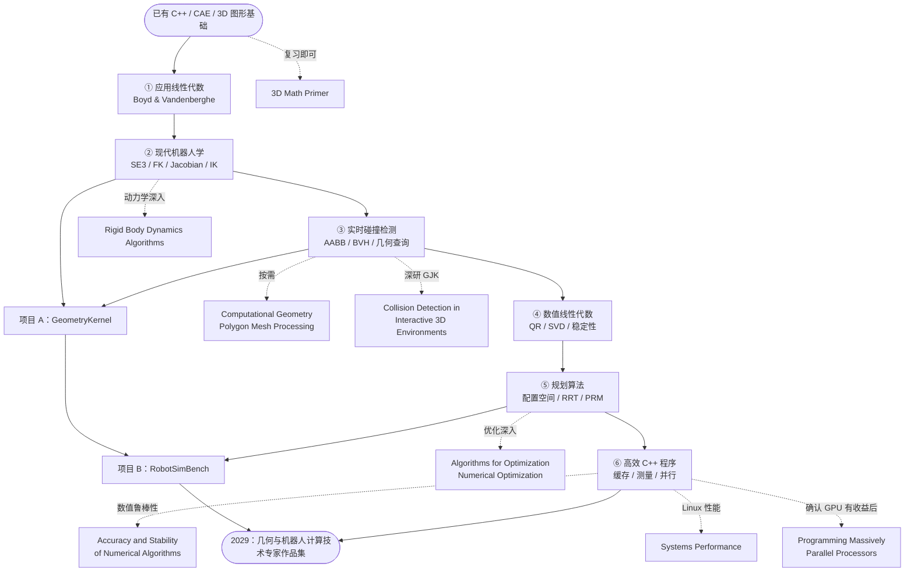

# CAE → 机器人仿真核心算法专家：三年阅读路线图

> **适用对象**：已有 C++17、Qt/OSG/OpenGL、CAE 后处理、计算几何、跨平台工程经验的研发工程师。  
> **目标定位**：高性能 C++ 几何计算、碰撞检测、机器人运动学与运动规划方向的**技术专家**，而不是 UI 工程师、通用机器人集成工程师或 VLA 模型训练研究员。  
> **就业约束**：长沙本地优先；只考虑无需迁居的长期远程机会。  
> **规划周期**：2026-11 至 2029-10。  
> **制定日期**：2026-10-27。  
> **时间预算**：假设每周 6～8 小时；书籍应与算法实现同步进行，**不要求每本书从头到尾通读**。

## 0. 先看结论：最重要的六本书

如果只想知道**必须先读什么**，按以下顺序开始。这六本书是三年的主线，其他书都是为具体问题服务的分支。

| 主线序号 | 书籍（原文书名） | 核心价值 | 开始阶段 |
|---:|---|---|---|
| **1** | *Introduction to Applied Linear Algebra: Vectors, Matrices, and Least Squares* | 数值线性代数与最小二乘，服务 IK 与稳定求解 | 第 1 年前 2 个月 |
| **2** | *Modern Robotics: Mechanics, Planning, and Control* | 从 SE(3) 到 FK、Jacobian、IK、动力学 | 第 1 年前 4 个月，第二年回读 |
| **3** | *Real-Time Collision Detection* | BVH、相交、距离、鲁棒性、几何查询优化 | 第 1 年核心教材 |
| **4** | *Numerical Linear Algebra* | QR、SVD、条件数、稳定性，不把误差当算法结果 | 第 1 年末至第 2 年初 |
| **5** | *Planning Algorithms* | 配置空间、RRT/PRM、碰撞约束下的路径规划 | 第 2 年 |
| **6** | *The Art of Writing Efficient Programs* | C++ 性能、缓存、并发与基准测试 | 第 2 年末至第 3 年 |

> **你的知识背景决定了次序**：已有三维矩阵与渲染经验，不必重新从 OpenGL / 《实时渲染》开始。先补数值与机器人运动学，再攻克实时碰撞与空间查询，之后研究规划、物理与性能。

## 1. 图形化学习路线图（Mermaid）

> GitHub 可直接渲染以下 Mermaid；部分本地 Markdown 阅读器若不支持 Mermaid，直接看下方的顺序表即可。

**图示规则**：实线为主学习路线；虚线为**项目驱动的选读 / 查阅**，不是每一本都必须读完。

## 2. 完整书单（16 本，按首次接触的建议顺序）

优先级说明：

- **A｜主线精读（6 本）**：选定重点章节认真推导、实现、做题；不是整本背诵。
- **B｜项目选读（5 本）**：当你做到对应算法或仿真阶段再深入。
- **C｜工具书 / 分支延伸（5 本）**：查缺补漏；可以不读整本，不影响主线完成。

| 顺序 | 优先级 | 书籍 | 作者 / 推荐版本 | 进入时间 | 最值得学习的内容 |
|---:|:---:|---|---|---|---|
| 00 | C | *3D Math Primer for Graphics and Game Development* | Fletcher Dunn、Ian Parberry；第 2 版（2011） | 入门前，按需快读 | 坐标、变换、旋转、运动学复习 |
| **01** | **A** | *Introduction to Applied Linear Algebra: Vectors, Matrices, and Least Squares* | Stephen Boyd、Lieven Vandenberghe（2018） | 第 1 年 M1–M2 | 最小二乘、线性方程、矩阵、约束 |
| **02** | **A** | *Modern Robotics: Mechanics, Planning, and Control* | Kevin M. Lynch、Frank C. Park；2017 / 更新版预印本 2019 | 第 1 年 M1–M4；第 2 年回读 | SE(3)、FK、Jacobian、IK、轨迹、动力学 |
| **03** | **A** | *Real-Time Collision Detection* | Christer Ericson（2004） | 第 1 年 M3–M10 | BVH、空间查询、SAT、凸体、鲁棒性 |
| 04 | B | *Computational Geometry: Algorithms and Applications* | Mark de Berg 等；第 3 版（2008） | 第 1 年 M5–M10 | 计算几何数据结构与算法分析 |
| 05 | C | *Polygon Mesh Processing* | Mario Botsch 等（2010） | 第 1 年 M7–M12 | 网格结构、简化、修复、拓扑与数值 |
| **06** | **A** | *Numerical Linear Algebra* | Lloyd N. Trefethen、David Bau III；1997 / 25 周年版 | 第 1 年 M10～第 2 年 M2 | 数值稳定性、QR、SVD、迭代求解 |
| **07** | **A** | *Planning Algorithms* | Steven M. LaValle（2006） | 第 2 年 M1–M6 | 配置空间、采样式运动规划、RRT / PRM |
| 08 | B | *Collision Detection in Interactive 3D Environments* | Gino van den Bergen（2003） | 第 2 年 M3–M7 | GJK、凸体距离、支持映射与宽相 |
| 09 | B | *Algorithms for Optimization* | Mykel J. Kochenderfer、Tim A. Wheeler；第 1 版（2019） | 第 2 年 M5–M10 | 无约束 / 约束优化、梯度方法、数值方法 |
| 10 | B | *Rigid Body Dynamics Algorithms* | Roy Featherstone（2008） | 第 2 年 M7–M12 | 6D 空间向量、RNEA、CRBA、ABA |
| 11 | C | *A Mathematical Introduction to Robotic Manipulation* | Richard M. Murray、Zexiang Li、S. Shankar Sastry（1994） | 第 2 年以后 | 用更深入的数学理解机器人刚体运动与操作 |
| **12** | **A** | *The Art of Writing Efficient Programs* | Fedor G. Pikus（2021） | 第 2 年末～第 3 年 | C++ 性能、缓存、CPU、并发、基准测试 |
| 13 | B | *Systems Performance: Enterprise and the Cloud* | Brendan Gregg；第 2 版（2020） | 第 3 年 M1–M6 | Linux perf、CPU / 内存观测、系统性能分析 |
| 14 | C | *Accuracy and Stability of Numerical Algorithms* | Nicholas J. Higham；第 2 版（2002） | 第 3 年，按问题查阅 | 浮点、条件数、误差传播、数值算法正确性 |
| 15 | C | *Programming Massively Parallel Processors: A Hands-on Approach* | Wen-mei W. Hwu、David B. Kirk、Izzat El Hajj；**第 5 版（2026）** | 第 3 年，确认需要 GPU 后 | CUDA、GPU 内存、归约、Scan、并行算法 |

> **补充进阶参考（不计入 16 本）**：如果进入数值优化核心研发，可用 Jorge Nocedal / Stephen J. Wright 的 *Numerical Optimization*（第 2 版，2006）替代或补充表中第 09 本；它数学要求更高，没必要与 *Algorithms for Optimization* 同时通读。

### 不建议你重新系统学习的内容

已有经验足够时，可把以下材料只作为参考：

- 《Real-Time Rendering, 4th Edition》：按需查渲染和 GPU 章节，无需重新从光栅化开始。
- OSG / OpenGL / Qt 基础教材：无需回炉；这些已经是你的既有优势。
- 一般 C++ 入门教材：将精力转向数值可靠性、算法复杂度、缓存与实际 Profiling。
- VLA / 大语言模型训练的系统性教材：在三年主线里暂缓，先确保机器人仿真计算能力有扎实成果。

## 3. 分阶段详细阅读指南

### 阶段 I：数学与机器人运动学（2026.11—2027.02）

#### 00｜*3D Math Primer for Graphics and Game Development* — C / 快速复习

- **只读**：坐标系、向量 / 矩阵、旋转表达、运动学和动力学相关章节；已经理解的内容直接跳过。
- **目的**：从图形学“模型矩阵”思维过渡到机器人“坐标系链与刚体状态”思维。
- **C++ 验收**：写出 `Transform3D`，测试组合变换、逆变换、旋转的数值行为。
- **资源**：[作者介绍](https://ianparberry.com/books/3dmathprimer/) · [作者网站（可在线免费阅读）](https://gamemath.com/)

#### 01｜*Introduction to Applied Linear Algebra* — A / 主线精读

- **重点**：向量范数与距离、矩阵、线性方程、矩阵乘法与逆、最小二乘、非线性最小二乘。
- **建议章节**：第 3、6、8、10–12、18 章；前面缺基础时再补相应章节。
- **注意**：该书较偏应用，**不系统覆盖特征值与特征向量**；之后用《Numerical Linear Algebra》或其他材料补齐。
- **C++ 验收**：用 Eigen 实现最小二乘（对比 QR、SVD 和直接正规方程），检查病态矩阵对结果的影响。
- **资源**：[作者官方免费在线版](https://web.stanford.edu/~boyd/vmls/)

#### 02｜*Modern Robotics: Mechanics, Planning, and Control* — A / 机器人学总主教材

- **第一轮精读**：第 2 章 Configuration Space、第 3 章 Rigid-Body Motions、第 4 章 Forward Kinematics、第 5 章 Velocity Kinematics and Statics、第 6 章 Inverse Kinematics。
- **第二轮回读（第二年）**：第 8 章 Dynamics of Open Chains、第 9 章 Trajectory Generation、第 10 章 Motion Planning、第 11 章 Robot Control。
- **本书不必一开始全读**：第 7 章闭链机构、第 12 章抓取操作、第 13 章移动机器人，视研究方向延后。
- **C++ 验收**：实现基于指数积（PoE）的 FK、空间 / 本体 Jacobian，以及阻尼最小二乘 IK；对随机姿态做有限差分一致性检验。
- **资源**：[作者 / 学校官方主页（中文版本信息、免费预印本、视频与习题）](https://hades.mech.northwestern.edu/index.php/Modern_Robotics)

### 阶段 II：几何、空间数据结构与碰撞（2027.02—2027.10）

#### 03｜*Real-Time Collision Detection* — A / 第一年的核心算法教材

- **必读章节**：Ch.2（系统设计考量）；Ch.4（包围体）；Ch.5（基础几何检测）；Ch.6（BVH）；Ch.9（凸体方法）；Ch.11–12（数值 / 几何鲁棒性）；Ch.13（优化）。
- **按需阅读**：Ch.7（空间划分）、Ch.8（BSP）、Ch.10（书中的 GPU 辅助方法，属于较早年代的实现背景）。
- **C++ 验收**：AABB、Ray–Triangle、Triangle–Triangle、点到三角形最近点、BVH 构建 / 遍历；制造退化三角形、近切触和极端尺寸输入进行测试。
- **关键标准**：算法不是“场景里能跑”就算正确，要写单元 / 随机 / 差异测试，并将耗时、内存峰值、P95 延迟分别测量。
- **资源**：[出版社书目与目录](https://www.routledge.com/Real-Time-Collision-Detection/Ericson/p/book/9781558607323)

#### 04｜*Computational Geometry: Algorithms and Applications* — B / 算法理论参考

- **重点主题**：线段相交、点定位、凸包、空间搜索、平面划分、机器人运动规划的几何背景。不同版本目录安排可能变化，**优先按主题检索**。
- **目的**：从工程实现上升到算法复杂度、正确性证明、退化情况处理。
- **C++ 验收**：为一个空间查询算法给出时间 / 空间复杂度说明，并将理论分析与实测规模增长曲线比较。
- **资源**：[Springer 第三版](https://link.springer.com/book/10.1007/978-3-540-77974-2)

#### 05｜*Polygon Mesh Processing* — C / CAE 特有问题的增强模块

- **选读章节**：Ch.2 Mesh Data Structures；Ch.7 Simplification & Approximation；Ch.8 Model Repair；附录 Numerics。
- **目的**：补足半边 / 边拓扑、网格简化、缺陷修复、非流形输入处理，与现有 CAE 工作直接关联。
- **C++ 验收**：实现网格边关联统计、退化与孔洞候选诊断、简化前后网格的质量和误差报告。
- **资源**：[出版社书目](https://www.routledge.com/Polygon-Mesh-Processing/Alliez-Botsch-Kobbelt-Levy-Pauly/p/book/9781568814261) · [作者配套资料和代码](https://www.pmp-book.org/)

### 阶段 III：规划、距离查询与仿真动力学（2027.09—2028.10）

#### 06｜*Numerical Linear Algebra* — A / 数值算法稳定性

- **重点主题**：QR 分解、SVD、条件数、特征问题、迭代法和数值稳定性（按主题选择对应 Lecture）。
- **C++ 验收**：对比正规方程、QR 与 SVD 在病态 IK / 最小二乘问题中的差异；测试 `float` / `double`、不同尺度下的误差。
- **资源**：[作者书籍页面](https://people.maths.ox.ac.uk/trefethen/text.html) · [SIAM 25 周年版](https://epubs.siam.org/doi/book/10.1137/1.9781611977165)

#### 07｜*Planning Algorithms* — A / 第二年的运动规划主教材

- **重点章节**：Ch.3 几何表示与变换、Ch.4 配置空间、Ch.5 采样式运动规划。
- **后续选读**：Ch.2 图搜索、Ch.7 含时间和复杂约束的规划问题。
- **C++ 验收**：先做二维 RRT，再实现 6 轴机械臂关节空间 RRT-Connect（可自行研究拓展），通过自己的碰撞接口判定状态是否合法；与 OMPL 在**相同场景和条件**下进行对照。
- **资源**：[作者官方免费在线书籍和章节 PDF](https://lavalle.pl/planning/)

#### 08｜*Collision Detection in Interactive 3D Environments* — B / GJK 专项深入

- **重点章节**：Ch.3 Basic Primitives；Ch.4 Convex Objects（尤其 GJK）；Ch.5 Spatial Data Structures。
- **C++ 验收**：实现支持映射与基础 GJK，测试凸多面体的碰撞 / 距离，和 FCL 等成熟实现交叉验证。
- **提醒**：GJK、EPA、连续碰撞检测相关实现各有适用前提；不要认为读完 GJK 就等于实现完整鲁棒碰撞系统。
- **资源**：[出版社书目与目录](https://shop.elsevier.com/books/collision-detection-in-interactive-3d-environments/van-den-bergen/978-1-55860-801-6)

#### 09｜*Algorithms for Optimization* — B / 工程优化入门

- **重点主题**：梯度与数值差分、无约束优化、约束优化、搜索方向和停止条件、实验评价。
- **C++ 验收**：给数值 IK 加入关节偏好 / 限位权重，比较不同目标函数与步长策略的稳定性。
- **版本说明**：建议以**2019 年第一版**入门；出版社已公告第二版拟于 2027 年上市，实际学习时可以考虑更新版本。
- **资源**：[MIT Press 第一版](https://mitpress.mit.edu/9780262039420/algorithms-for-optimization/) · [第二版信息](https://mitpress.mit.edu/9780262058162/algorithms-for-optimization/)
- **深度替代（不是额外必读）**：[Nocedal & Wright：*Numerical Optimization*, 2nd ed.](https://link.springer.com/book/10.1007/978-0-387-40065-5)

#### 10｜*Rigid Body Dynamics Algorithms* — B / 若深入物理求解器则精读

- **进入门槛**：先学《Modern Robotics》第 8 章，能理解质量、惯量、力矩、逆 / 正动力学。
- **重点主题**：Spatial Vector Algebra、Rigid Body Dynamics、Inverse Dynamics、Forward Dynamics。
- **C++ 验收**：从单摆 / 二连杆开始，实现简化逆动力学或前向动力学，和 MuJoCo 或 Pinocchio 进行数值对照。
- **特别提醒**：**不以三年内重写商用物理引擎为目标**。如果工作更偏碰撞检测或几何查询，此书降为查阅即可。
- **资源**：[Springer 官方书目](https://link.springer.com/book/10.1007/978-1-4899-7560-7)

#### 11｜*A Mathematical Introduction to Robotic Manipulation* — C / 机器人数学深化

- **推荐情况**：当你希望深入 Lie 群、指数映射、机器人操作的几何与力学表达时阅读；已有《Modern Robotics》足够入门。
- **推荐章节**：Ch.2 Rigid Body Motion、Ch.3 Manipulator Kinematics、Ch.4 Robot Dynamics and Control。
- **版权与获取提醒**：作者维护了配套页面，但根据作者网站说明，出版社已撤销公开提供整书 PDF 的许可；请走合法购买 / 图书馆渠道。
- **资源**：[作者官方档案](https://www.cds.caltech.edu/~murray/books/MLS/) · [图书页面](https://www.routledge.com/A-Mathematical-Introduction-to-Robotic-Manipulation/Murray-Li-Sastry/p/book/9780849379819)

### 阶段 IV：高性能、鲁棒性与工业级验证（2028.09—2029.10）

#### 12｜*The Art of Writing Efficient Programs* — A / C++ 性能主教材

- **重点主题**：基准测量、CPU 微架构、缓存与内存访问、多线程、并发的收益与代价、编译器优化。
- **C++ 验收**：以 `GeometryKernel` 的 BVH 查询为实验对象，对比 AoS / SoA、不同构建策略、批量查询、线程数、编译选项，并形成**可复现的 Benchmark**。
- **资源**：[Packt 官方书目](https://www.packtpub.com/en-us/product/the-art-of-writing-efficient-programs-9781800208117)

#### 13｜*Systems Performance: Enterprise and the Cloud* — B / Linux 系统分析参考

- **选读章节**：Ch.2 Methodology、Ch.4 Observability Tools、Ch.5 Applications、Ch.6 CPUs、Ch.7 Memory、Ch.12 Benchmarking、Ch.13 perf；必要时补 Ch.15 BPF。
- **目的**：区分算法自身耗时与操作系统、CPU 频率、调度、内存分配、缓存、IO 等因素造成的性能变化。
- **C++ 验收**：用 Linux `perf`、火焰图等方法做一次项目全链路瓶颈分析，不仅依赖计时器。
- **资源**：[作者官方页面和完整目录](https://www.brendangregg.com/systems-performance-2nd-edition-book.html)

#### 14｜*Accuracy and Stability of Numerical Algorithms* — C / 数值鲁棒性百科

- **建议按问题查阅**：IEEE 浮点误差模型、条件数、误差传播、线性方程求解、矩阵分解与数值稳定。
- **C++ 验收**：针对几何近共面、近相切、几何尺度悬殊、IK 接近奇异等情况设计自动回归测试，并解释误差来源。
- **资源**：[作者官方页面（目录等资料）](https://nhigham.com/accuracy-and-stability-of-numerical-algorithms/)

#### 15｜*Programming Massively Parallel Processors* — C / GPU 加速条件分支

- **版本**：第 5 版，2026 年发行；不必购买旧版才能学习。
- **选读章节**：Ch.2–6 GPU 基础与内存 / 性能，Ch.10 Reduction、Ch.11 Prefix Sum、Ch.13 Sorting、Ch.15 Sparse Matrix Computation、Ch.17 Graph Traversal；按实际需求选择。
- **C++ 验收**：先 Profile 证明批量空间查询 / 构建 / 归约有 GPU 加速潜力，再建立 CPU 与 GPU 的端到端对照（含数据传输和同步）。
- **不适用情况**：少量、延迟敏感的几何查询，或硬件 / 生态不能接受 CUDA 依赖时，暂时不学此分支。
- **资源**：[Elsevier 第五版官方页面及目录](https://shop.elsevier.com/books/programming-massively-parallel-processors/hwu/978-0-443-43900-1)

## 4. 三年时间线：用书籍推动项目，而不是用项目填补读书进度

| 时段 | 主线书籍 | 本阶段最少交付的代码成果 |
|---|---|---|
| **2026 Q4** | 01《Applied Linear Algebra》+ 02《Modern Robotics》2–3 章 | `SE3` / 坐标变换 / 旋转数值测试 |
| **2027 Q1** | 02 第 4–6 章 + 03《Real-Time Collision Detection》前半 | FK / Jacobian / IK；基础几何查询 |
| **2027 Q2** | 03 Ch.4–7 + 04 按需 | AABB / BVH / Raycast，100K/1M 三角面数据集测试 |
| **2027 Q3** | 03 Ch.9、11–13 + 05 按需 | 最近点、退化输入、凸体碰撞研究 |
| **2027 Q4** | 06《Numerical Linear Algebra》+ 07《Planning Algorithms》入门 | 数值稳定性实验、RRT 原型 |
| **2028 Q1** | 07 第 3–5 章 + 08 选读 | 6 轴机械臂碰撞与规划；与 OMPL 对照 |
| **2028 Q2** | 09《Algorithms for Optimization》+ 回读 02 Ch.8–10 | IK 约束优化、基础动力学接入 |
| **2028 Q3–Q4** | 10《Rigid Body Dynamics Algorithms》视工作需要 | MuJoCo / Pinocchio 结果对照、RobotSimBench v1 |
| **2029 Q1** | 12《Art of Writing Efficient Programs》 | 用基准证明算法瓶颈及优化收益 |
| **2029 Q2** | 13《Systems Performance》选读 | CPU / 内存 / cache / 分配器剖析报告 |
| **2029 Q3** | 14 数值稳定性专题；15 GPU 条件分支 | 鲁棒性回归、必要时 GPU 端到端对比 |
| **2029 Q4（至 10 月）** | 回读关键章节，不新开大书 | GeometryKernel + RobotSimBench + 专题技术报告 |

*表中的月份 / 季度指建议首次重点阅读的窗口，可重叠。允许根据工作任务前移、后移；不要因为未完成选读书籍而推迟核心项目。*

## 5. 两个项目与书籍的映射

### 项目 A｜GeometryKernel（第 1 年启动、三年持续）

| 模块 | 必读 / 选读来源 | 验收方式 |
|---|---|---|
| 数学与数值基类 | 01、06 | 残差、精度、病态输入测试 |
| 基础空间查询 | 03 | Raycast、最近点和三角相交 |
| BVH / 空间索引 | 03、04 | 不同网格规模、查询分布的 Benchmark |
| 网格拓扑鲁棒性 | 03、05、14 | 非流形、缺口、退化测试用例 |
| GJK / 凸体碰撞 | 03、08 | 和成熟碰撞库的差异测试 |
| 高性能优化 | 12、13；15 可选 | CPU / GPU 的公平对照、测量报告 |

### 项目 B｜RobotSimBench（第 2 年启动）

| 模块 | 必读 / 选读来源 | 验收方式 |
|---|---|---|
| FK / Jacobian / IK | 01、02、06 | 机械臂模型验证；有限差分对照 |
| 机器人配置空间 / 路径规划 | 02、07 | RRT-Connect / OMPL 对照 |
| 几何碰撞 / 距离 | 03、08 + GeometryKernel | 动态场景和避障数据集 |
| 动力学 / 仿真步进 | 02、10 | 与 MuJoCo 或 Pinocchio 结果对照 |
| 轨迹评价、算法优化 | 09、12、13 | 成功率、耗时、碰撞检查次数、P95 延迟 |

## 6. 针对你的实际条件，怎么执行最省时间

### 每周建议节奏（6～8 小时）

- **2 小时**：读主线章节并推导核心公式。
- **3～4 小时**：用 C++ 实现、对照成熟库、做自动化测试。
- **1～2 小时**：做 Benchmark、记误差案例、更新项目文档和学习笔记。

### 阅读一个章节的完成标准

不要按页数打勾，达到以下四点才算完成：

- [ ] 能用自己的话解释算法输入、输出、适用前提。
- [ ] 能写出核心数学表达或伪代码，并解释退化情况。
- [ ] 有一个最小可运行 C++ 样例及测试。
- [ ] 能说清性能、内存、精度之间的主要权衡。

### 可以直接略过的方向

- **不以仿真渲染 UI 为主线**：你已有 Qt / OSG / OpenGL 能力。
- **不以从零开发物理引擎为目标**：深入理解 MuJoCo 等库足够支撑第二年起步。
- **不为凑技术栈学 CUDA**：有明确 Profiling 和性能收益证据再开始。
- **不强求每个算法都原创**：工业级价值在正确性、稳定性、性能证据与工程取舍。

## 7. 购书 / 获取优先级（避免一次购买全部）

**先打开免费的官方资源**：

1. [Introduction to Applied Linear Algebra（作者免费全文）](https://web.stanford.edu/~boyd/vmls/)
2. [Modern Robotics（作者授权免费预印本、配套视频、习题）](https://hades.mech.northwestern.edu/index.php/Modern_Robotics)
3. [Planning Algorithms（作者免费在线阅读及章节 PDF）](https://lavalle.pl/planning/)
4. [3D Math Primer（作者网站在线全文）](https://gamemath.com/)
5. [Polygon Mesh Processing（免费配套幻灯片 / 代码，不是免费整书）](https://www.pmp-book.org/)

**如果只准备购买一本纸质书**：优先购买 *Real-Time Collision Detection*。它最贴合第一年的核心几何算法项目，而且应反复查阅。

**第二批按项目选择**：

- 专攻 GJK：买 *Collision Detection in Interactive 3D Environments*。
- 决定深入刚体动力学：买 *Rigid Body Dynamics Algorithms*。
- 开始系统性能优化：买 *The Art of Writing Efficient Programs*；Linux 观测需要时再添 *Systems Performance*。
- 真正需要数值精度深入研究：查阅或购买 *Accuracy and Stability of Numerical Algorithms*。
- 确认 GPU 加速值得投入：再买 *Programming Massively Parallel Processors*, 5th ed.

> **版权说明**：这里的免费资源仅指作者或权利人官方许可的渠道。没有提供非授权书籍下载链接。

## 8. 第一批行动清单（马上开始）

- [ ] 打开《Introduction to Applied Linear Algebra》，复习最小二乘与矩阵求解。
- [ ] 打开《Modern Robotics》官网，下载最新版官方预印本，先学第 2–3 章。
- [ ] 创建 `GeometryKernel` C++17 + CMake + CTest 仓库，添加 Eigen 与测试框架。
- [ ] 实现 SE(3) 组合变换、逆变换和基本数学单元测试。
- [ ] 用机械臂 FK 作为第一个数学驱动的代码练习。
- [ ] 之后开始《Real-Time Collision Detection》Ch.4–6，实现 AABB/BVH。

---

**三年总体目标不是“读完 16 本书”**，而是通过 **6 本主线 + 项目驱动选读**，形成两份能够展示算法原理、正确性、鲁棒性和性能结果的 C++ 代码作品：`GeometryKernel` 与 `RobotSimBench`。这才是从 CAE 渲染开发向机器人仿真核心算法技术专家转型的可验证证据。
