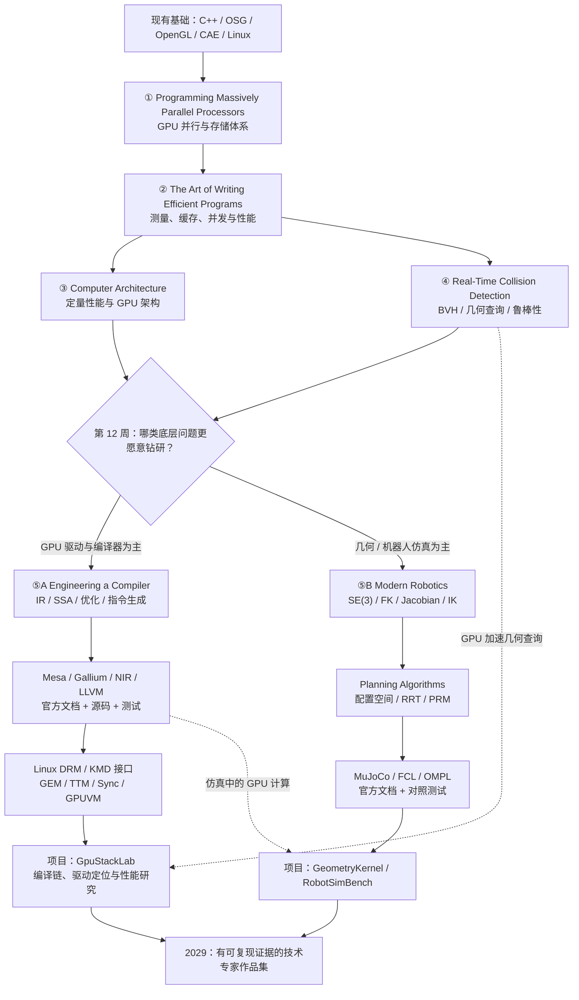

# GPU 系统软件 × 几何计算 × 机器人仿真：三年书籍阅读规划（V2）

> **规划周期**：2026 年 11 月—2029 年 10 月  
> **版本**：V2 · 2026-10-27  
> **职业目标**：在长沙本地或真正长期远程的岗位中，成长为 **高性能 C++ / GPU 系统软件技术专家**；以 **GPU 用户态驱动、Shader 编译器与 GPU 性能** 为主要探索方向，以 **CAE 几何计算 / 机器人仿真** 为应用与备选专长。  
> **已有基础**：C++17、Qt/OSG/OpenGL、CAE 后处理、GPU 渲染、跨平台适配、Linux 图形栈、CMake/Ninja。  
> **假设投入**：在职学习，每周 **6～8 小时**；先用 12 周验证兴趣，再决定三年主攻方向。  
> **重要说明**：本计划不是从头到尾通读 16 本书的考试计划。**书籍负责理论，官方文档负责现实接口与代码，项目负责证明能力。**

---

## 0. 结论：先读哪几本？

### 不想研究复杂目录，就先按这个顺序

| 起步顺序 | 书籍 | 优先级 | 核心问题 | 第一轮目标 |
|---:|---|---|---|---|
| **1** | **Programming Massively Parallel Processors（第 5 版）** | **A / 核心** | GPU 为什么快，什么时候不快？ | GPU 架构、存储、并行模式与性能 |
| **2** | **The Art of Writing Efficient Programs（第 2 版）** | **A / 核心** | 如何科学测量并优化 C++？ | 基准测试、Profiler、Cache、SIMD 与并发 |
| **3** | **Computer Architecture: A Quantitative Approach（第 7 版）** | **A / 核心·选章** | 硬件如何决定软件性能？ | 内存层级、SIMD / GPU、定量设计 |
| **4** | **Real-Time Collision Detection** | **A / 核心·选章** | 几何查询怎样做得快而可靠？ | AABB、BVH、距离、数值鲁棒性 |
| **5A** | **Engineering a Compiler（第 3 版）** | **GPU 分支核心** | Shader 怎么变成 GPU 可执行指令？ | IR、数据流分析、指令选择、调度、寄存器分配 |
| **5B** | **Modern Robotics** | **机器人分支核心** | 关节、位姿与运动如何数学建模？ | SE(3)、FK、Jacobian、IK、动力学概要 |

**读法：前 12 周先接触 1—4 的重点部分和 Mesa 官方文档；之后在 5A（GPU 编译器）与 5B（机器人计算）之间选一个主攻。**另一个方向保留约 20%～30% 的学习时间即可。不要同时给两个方向都设定“精通”目标。

**关于新版本**：上述第 1 本的第 5 版于 2026 年出版；第 2 本在 2026 年 9 月推出了第 2 版；第 3 本已有 2025 年第 7 版。购书时请核对版本，不必沿用旧书单中的版本。

---

## 1. 图形化阅读路线图

> 下方 Mermaid 在 GitHub、支持 Mermaid 的 Markdown 编辑器中可以直接渲染。如果预览不支持，直接按第 2 节和第 4 节的表格学习。



**你的最终技术标签建议**：**C++ 高性能计算 + GPU 系统软件**，而不是“同时精通 GPU RTL、驱动、VLA、物理求解器、机器人控制和新渲染框架”。GPU **芯片 RTL/数字 IC 设计不纳入三年主线**；它与当前软件研发能力之间仍有较高的重新学习成本。

---

## 2. 完整书单：16 本，按首次建议接触的顺序

### 优先级解释

- **A｜主干必修（4 本）**：重点章节精读并做实践；所有路线都值得读。
- **G｜GPU 分支核心（1 本）**：决定深入 GPU 编译器 / UMD 后精读核心章节。
- **R｜机器人分支核心（1 本）**：决定深入机器人计算后精读核心章节。
- **B｜按项目选读（6 本）**：与当前算法问题相关时查对应章节。
- **C｜专家参考（4 本）**：仅在研究深入时阅读，不设通读任务。

| # | 类别 | 书名、作者、版本 | 建议初次阅读 | 具体价值 |
|---:|:---:|---|---|---|
| **01** | **A** | *Programming Massively Parallel Processors: A Hands-on Approach* — Hwu / Kirk / El Hajj；**第 5 版，2026** | 2026 Q4 | GPU 计算、存储与并行算法模式 |
| **02** | **A** | *The Art of Writing Efficient Programs* — Fedor G. Pikus；**第 2 版，2026** | 2026 Q4 | 性能测量、CPU 缓存、编译优化和并发 |
| **03** | **A** | *Computer Architecture: A Quantitative Approach* — Hennessy / Patterson / Kozyrakis；**第 7 版，2025** | 2027 Q1 | 体系结构、SIMD/GPU、数据驱动性能建模 |
| **04** | **A** | *Real-Time Collision Detection* — Christer Ericson；第 1 版，2004/2005 | 2026 Q4—2027 Q2 | 几何检测、BVH、鲁棒性、高性能查询 |
| **05** | **G** | *Engineering a Compiler* — Cooper / Torczon；**第 3 版，2022** | 2027 Q2，若 GPU 编译器为主 | 编译器中间表示、优化、指令生成 |
| **06** | **R** | *Modern Robotics: Mechanics, Planning, and Control* — Lynch / Park；2017 | 2027 Q2，若机器人算法为主 | 机器人数学、运动学与动力学 |
| **07** | **B** | *Systems Performance: Enterprise and the Cloud* — Brendan Gregg；第 2 版，2020/2021 | 2027 Q3—2028 | Linux perf、观测、内存和瓶颈定位 |
| **08** | **B** | *Computer Systems: A Programmer's Perspective* — Bryant / O'Hallaron；第 3 版，2015/2016 | 2027—2028，按需 | 机器级程序、链接、虚拟内存、系统执行模型 |
| **09** | **B** | *The Linux Programming Interface* — Michael Kerrisk；2010 | 2028，按需 | Linux 系统调用、文件、内存映射、同步 |
| **10** | **B** | *Introduction to Applied Linear Algebra* — Boyd / Vandenberghe；2018 | 2027，数学不足时 | 最小二乘、矩阵、向量、数值求解 |
| **11** | **B** | *Numerical Linear Algebra* — Trefethen / Bau；1997，2022 纪念版 | 2028，数值专题 | QR、SVD、条件数、数值稳定性 |
| **12** | **B** | *Planning Algorithms* — Steven M. LaValle；2006 | 2028，若做运动规划 | C-space、RRT、PRM、约束规划 |
| **13** | **C** | *Computational Geometry: Algorithms and Applications* — de Berg 等；第 3 版，2008 | 2028+，几何深研 | 几何算法正确性、复杂度、空间数据结构 |
| **14** | **C** | *Collision Detection in Interactive 3D Environments* — Gino van den Bergen；2003 | 2028+，GJK 深研 | 凸体碰撞、支持映射、距离查询 |
| **15** | **C** | *Rigid Body Dynamics Algorithms* — Roy Featherstone；2008 | 2028+，动力学深研 | RNEA、CRBA、ABA 与刚体动力学 |
| **16** | **C** | *Algorithms for Optimization* — Kochenderfer / Wheeler；2019 版 | 2028+，算法优化深研 | 梯度、数值优化与约束问题 |

**重要提醒：**书目按“首次阅读”排列，不代表必须逐本读完才能进入下一本。比如第 4 本《Real-Time Collision Detection》要从第一年读起，同时穿插第 1—3 本；第 5 与第 6 本是**分叉项，不要求都精读**。

---

## 3. 每本书到底读什么、做什么？

### 01｜Programming Massively Parallel Processors · A

- **推荐版本**：第 5 版（2026）。
- **第一轮必读**：第 1—6 章（异构数据并行、计算架构、存储层级与性能）；第 9—11 章（Histogram、Reduction、Scan）。
- **第二轮选读**：稀疏矩阵、图遍历、矩阵乘优化等与你的 CAE / 网格数据匹配的主题；第 5 版目录对应第 15、17、23 章等。
- **实践**：实现 `reduce`、`scan`、简单网格过滤，记录 GPU/CPU 时间、数据传输开销、吞吐量与正确性。
- **重要前提**：书中大量示例采用 CUDA。如果没有兼容 NVIDIA GPU，可以先学架构原理和算法，以 Vulkan Compute / 其他可用 GPU API 做近似对应实验，**不要假设 CUDA 代码能直接在所有国产 GPU 上运行**。
- **官方来源**：[Elsevier 第 5 版](https://shop.elsevier.com/books/programming-massively-parallel-processors/hwu/978-0-443-43900-1)

### 02｜The Art of Writing Efficient Programs · A

- **推荐版本**：**2026 年第 2 版**。优先读第 1—2 章（性能与测量）；其余按缓存、指令优化、编译器、并发、原子操作专题选择。
- **实践**：使用 Google Benchmark / Linux perf，测量 `AoS vs SoA`、顺序 vs 随机遍历、不同线程数对 BVH 查询的影响。
- **验收**：报告必须说明 CPU、编译器、优化参数、基准数据、重复次数；能解释优化收益与波动来源。
- **官方来源**：[Packt 第 2 版](https://www.packtpub.com/en-us/product/the-art-of-writing-efficient-programs-9781835466742)

### 03｜Computer Architecture: A Quantitative Approach · A

- **推荐版本**：第 7 版（2025）。
- **第一轮选读**：Ch.1 定量设计基础；Ch.2 Memory Hierarchy；Ch.4 SIMD 与 GPU 架构；Ch.7 Domain-Specific Architectures（按兴趣）。
- **实践**：为两类 GPU/CPU 算法建立一个简单 Roofline/吞吐量上界估算，观察瓶颈究竟是算术、显存、Cache 还是调度。
- **理由**：你想进入 GPU **芯片软件层**，需要从图形 API 视角走向处理器执行模型；**但不需要现在学 RTL**。
- **官方来源**：[Elsevier 第 7 版](https://shop.elsevier.com/books/computer-architecture/hennessy/978-0-443-15406-5)

### 04｜Real-Time Collision Detection · A

- **第一轮必读**：Ch.2 设计问题；Ch.4 包围体；Ch.5 几何基础测试；Ch.6 BVH；Ch.11—12 数值与几何鲁棒性；Ch.13 优化。
- **第二轮重点**：Ch.9 凸体方法；Ch.7 空间划分，按项目需要选择。
- **实践**：自己实现 AABB、Ray/Triangle、点到三角形距离、BVH 构建 / 查询，再用 FCL / 简单暴力查询做对照。
- **注意**：书中 Ch.10 的 GPU 技术背景较早，现代 GPU 实现要以当前 API、驱动和 Profiling 为准。
- **官方来源**：[CRC / Routledge 图书页面](https://www.routledge.com/Real-Time-Collision-Detection/Ericson/p/book/9781558607323)

### 05｜Engineering a Compiler · G（GPU 方向确定后）

- **推荐版本**：第 3 版（2022）。
- **必读**：Ch.1 编译概览；Ch.4 IR；Ch.8 优化导论；Ch.9 数据流分析；Ch.10 标量优化；Ch.11—13 指令选择、指令调度与寄存器分配。
- **快速浏览**：词法、语法与前端内容（你不是从零开发一门新编程语言）。
- **实践**：用 LLVM 教程写一段最小 IR，并完成一个可测试的简单优化 Pass；之后跟踪 Mesa NIR 中某个具体优化或 Lowering Pass。
- **边界**：Mesa NIR 和 LLVM IR 是不同体系，读 LLVM 教程有助于理解编译器思想，但**不能把 LLVM 的实现直接当作 Mesa NIR 的实现**。
- **官方来源**：[Elsevier 第 3 版](https://shop.elsevier.com/books/engineering-a-compiler/cooper/978-0-12-815412-0)

### 06｜Modern Robotics · R（机器人方向确定后）

- **第一轮必读**：Ch.2 Configuration Space；Ch.3 Rigid-Body Motions；Ch.4 FK；Ch.5 Jacobian；Ch.6 IK。
- **第二轮选读**：Ch.8 刚体动力学；Ch.9 轨迹；Ch.10 运动规划。
- **实践**：用 Eigen 实现 FK / Jacobian / 数值 IK；利用机器人模型做验证；不必先开发 UI。
- **免费资源**：作者公开**供个人学习使用**的预印本、视频与配套资料，遵守其授权要求。 [官方页面](https://modernrobotics.northwestern.edu/) · [作者预印本（PDF）](https://hades.mech.northwestern.edu/images/7/7f/MR.pdf)

### 07｜Systems Performance · B

- **建议阅读**：方法论、观测工具、应用、CPU、内存、Benchmark、`perf`、Ftrace、BPF 对应主题。
- **实践**：对同一个几何查询/Shader 编译批任务，用 `perf stat`、`perf record`、火焰图等找出真正的瓶颈。
- **注意**：这是 Linux 系统性能书，**不是 GPU 显存计数器和 Shader 执行模型的替代品**。
- **官方来源**：[作者主页](https://www.brendangregg.com/systems-performance-2nd-edition-book.html)

### 08｜Computer Systems: A Programmer's Perspective（CS:APP）· B

- **建议阅读**：Ch.3 机器级表示；Ch.5 程序优化；Ch.6 存储层级；Ch.7 链接；Ch.9 虚拟内存；Ch.12 并发。
- **实践**：查看 Release 编译后的汇编、缓存行为、共享库链接流程与地址空间布局。
- **原因**：在真正进入 UMD、编译器和 KMD 交界处时，理解“程序如何在系统上执行”非常关键。
- **官方来源**：[CMU CS:APP 网站](https://csapp.cs.cmu.edu/)

### 09｜The Linux Programming Interface · B

- **建议阅读**：系统调用、文件描述符、`mmap`、进程与线程、同步及设备 I/O 相关主题。
- **实践**：理解用户态访问 DRM render node 时涉及的文件、`ioctl`、映射和同步概念。
- **提醒**：该书是经典 Linux 用户态系统编程资料；**不是 2026 年 DRM 内核 API 手册**，最新 DRM 结构必须看内核官方文档。
- **官方来源**：[Michael Kerrisk 图书主页](https://michaelkerrisk.com/tlpi/index.html)

### 10｜Introduction to Applied Linear Algebra · B

- **选读**：向量/矩阵、范数、最小二乘、线性方程组与矩阵分解的应用。
- **实践**：比较正规方程、QR 与 SVD 在几何拟合、IK 或病态数据上的效果。
- **免费资源**：作者公开可合法在线阅读的版本。 [Stanford 官方主页](https://stanford.edu/~boyd/vmls/)

### 11｜Numerical Linear Algebra · B

- **选读**：QR、SVD、条件数、浮点稳定性、迭代求解。
- **实践**：比较 `float` / `double`、不同缩放和几何退化输入下的误差；如果做 GPU 算法，要对比 **性能与数值偏差**，而不只是输出“看起来一样”。
- **来源**：[25 周年版图书信息](https://epubs.siam.org/doi/book/10.1137/1.9781611977165)

### 12｜Planning Algorithms · B

- **选读**：配置空间、采样规划（尤其 RRT / PRM）、状态合法性与路径验证。
- **实践**：给机械臂状态查询接入自己的碰撞模块，与 OMPL 做相同场景的正确性及性能对照。
- **免费资源**：作者官方在线全文。 [LaValle 官方站](https://lavalle.pl/planning/)

### 13｜Computational Geometry: Algorithms and Applications · C

- **选读**：线段相交、点定位、空间查询、算法正确性证明、复杂度分析。已有 CAE 算法经验时按专题查询。
- **实践**：从理论复杂度出发解释 BVH 在不同查询分布下的实际表现。
- **来源**：[Springer 第 3 版](https://link.springer.com/book/10.1007/978-3-540-77974-2)

### 14｜Collision Detection in Interactive 3D Environments · C

- **选读**：GJK、凸体距离、支持映射、空间索引等专题。
- **实践**：实现可验证的 GJK 原型，加入相切 / 共面 / 退化数据回归测试。
- **来源**：[Elsevier 图书页面](https://shop.elsevier.com/books/collision-detection-in-interactive-3d-environments/van-den-bergen/978-1-55860-801-6)

### 15｜Rigid Body Dynamics Algorithms · C

- **选读**：Spatial Vector Algebra、RNEA、CRBA、ABA。
- **前提**：对刚体运动、惯性、力矩和约束有足够理解，且确实打算深入物理仿真求解器。
- **实践**：单摆 / 二连杆动力学与 MuJoCo / Pinocchio 的数值对照。
- **来源**：[Springer 图书页面](https://link.springer.com/book/10.1007/978-1-4899-7560-7)

### 16｜Algorithms for Optimization · C

- **选读**：梯度方法、约束优化、停止准则、数值评估；不要把它和《Numerical Linear Algebra》重复通读。
- **实践**：机器人 IK 限位优化，或编译参数/算法阈值的自动搜索实验。
- **来源**：[MIT Press 图书页面](https://mitpress.mit.edu/9780262039420/algorithms-for-optimization/)

---

## 4. 比“买书”更重要：必须同步阅读的官方技术文档

GPU 驱动和编译器是高度依赖源码版本的领域。下面的文档**不是可有可无的补充**，而是相当于一组不断更新的“活教材”。

| 推荐先后 | 官方资料 | 阅读重点 | 配合的书 |
|---:|---|---|---|
| D1 | [Mesa 总文档](https://docs.mesa3d.org/) | 图形 API、Mesa 组件、驱动与源码结构 | #01、#03 |
| D2 | [Gallium 文档](https://docs.mesa3d.org/gallium/index.html) | `pipe_screen`、`pipe_context`、resource、状态与驱动接口 | #03、#05 |
| D3 | [LLVMpipe 文档](https://docs.mesa3d.org/drivers/llvmpipe.html) | 使用 LLVM JIT 实现软件光栅化，构建与调试 | #02、#05 |
| D4 | [Mesa NIR 文档](https://docs.mesa3d.org/nir/index.html) | NIR、优化 Pass、Lowering、编译器测试 | #05 |
| D5 | [LLVM 官方教程](https://llvm.org/docs/tutorial/) + [新 Pass Manager](https://llvm.org/docs/WritingAnLLVMNewPMPass.html) | IR、最小优化 Pass、测试 | #05 |
| D6 | [Khronos Vulkan Guide](https://docs.vulkan.org/guide/latest/) + [Vulkan Tutorial](https://docs.vulkan.org/tutorial/latest/) | 显存、队列、同步、Pipeline、SPIR-V、Compute | #01、#03 |
| D7 | [Linux Kernel GPU Driver Developer's Guide](https://docs.kernel.org/gpu/) | DRM、GEM、TTM、GPUVM、Sync Object、GPU Scheduler、KMS | #08、#09 |
| D8 | [NVIDIA CUDA Programming Guide](https://docs.nvidia.com/cuda/cuda-programming-guide/index.html) | GPU 执行模型、GPU 编程与数据移动 | #01（有 NVIDIA 环境时可运行代码） |
| D9 | [MuJoCo 文档](https://mujoco.readthedocs.io/en/stable/overview.html) + [OMPL 文档](https://ompl.kavrakilab.org/) | 机器人物理仿真、运动规划的实物对照 | #06、#12 |

### 读 GPU 驱动源码的具体顺序

1. **先把路径画清楚**：应用 → OpenGL / Vulkan API → Mesa 用户态驱动 → 内核 DRM 接口 → GPU。不要把 X11、EGL、GLX、DRM、KMS 混为同一层。
2. **先研究一个能跑起来的驱动**：优先 `llvmpipe`，便于在无特定 GPU 的环境下调试 Mesa 的部分编译与光栅化路径。
3. **再读 NIR / Gallium**：追踪具体函数，而不是把 Mesa 整个源码目录逐个打开。
4. **再找真实 GPU 驱动作为对照**：例如 Mesa 中某个公开驱动的 Shader 编译或资源分配流程；能否运行取决于你的硬件与软件环境。
5. **最后接触 Linux DRM / KMD**：先能解释 `ioctl`、Buffer Object、同步和命令提交，暂时不用改内核。

> **纠正一个容易出现的误解**：`llvmpipe` 是在 **CPU 上**进行软件光栅化，其 LLVM IR 会编译成 CPU 机器码；它适合学习部分 Mesa / Gallium / LLVM 路径，**不能替代真实 GPU 的显存管理、硬件调度与指令后端学习**。
>
> **另外**，并非所有 OpenGL Shader 都按照 `GLSL → SPIR-V → NIR` 这条固定路径编译。Vulkan 与 OpenGL 的前端来源和处理流程可能不同，应以具体 Mesa 版本与实际驱动为准。

---

## 5. 三年按季度安排（12 个季度）

### 第一年：2026.11—2027.10｜GPU 基础 + 几何算法 + 驱动源码入门

| 时间 | 必看书 / 官方资料 | 当季工程产出 | 过关条件 |
|---|---|---|---|
| **2026.11—2027.01** | #01 前 6 章、#02 性能测量、#04 包围体入门；Mesa 总览 | `GpuStackLab` 初版：GPU/CPU 并行计算基准 + `GeometryKernel` AABB | 有正确性测试、环境记录、可复现性能数据 |
| **2027.02—04** | #03 Ch.1/2/4；#04 BVH；Vulkan Guide、LLVMpipe | CPU BVH 查询 Benchmark + Mesa 软件渲染最小调试实验 | 能解释 CPU 缓存和 GPU 存储/调度的差异 |
| **2027.05—07** | GPU 路线：#05 IR/数据流；几何路线：#06 FK/IK；NIR/LLVM 文档 | 选择主线：最小编译 Pass **或** 机械臂 FK/IK | 能从基本概念进入可测试的源码模块 |
| **2027.08—10** | 主线书继续 + #07 性能方法；Gallium / Mesa 测试文档 | 第一份完整技术报告：测量、定位、验证、优化 | 能独立解释至少一个真实技术瓶颈 |

### 第二年：2027.11—2028.10｜确定专业纵深，读真实实现

| 时间 | GPU 主线（推荐） | 几何/机器人辅线 | 当季工程产出 |
|---|---|---|---|
| **2027.11—2028.01** | #05 优化、指令选择、NIR 流水线 | #04 凸体方法与鲁棒性 | Shader 编译路径追踪、最小优化 Pass 与测试 |
| **2028.02—04** | Linux DRM 文档；#08/#09 只读系统接口部分 | #10 / #11 数值计算按需 | GPU 用户态与内核边界技术笔记；`libdrm` 信息查询小工具（条件允许时） |
| **2028.05—07** | #01 GPU 批处理/稀疏算法；#02 数据布局；GPU Profiler | `GeometryKernel` 距离查询与 BVH | CPU vs GPU 批量空间查询的正确性和端到端性能对照 |
| **2028.08—10** | #07 系统性能；结合具体驱动源码深化 | #06 / #12 机器人状态合法性 | 固定数据集、测试脚本、异常输入与性能报告 |

### 第三年：2028.11—2029.10｜做出有证据的专家成果

| 时间 | 核心工作 | 参考资料 | 当季工程产出 |
|---|---|---|---|
| **2028.11—2029.01** | 钻研一个 **可解释、可复现** 的低层问题（驱动编译、GPU 计算或几何性能） | NIR / LLVM / #02 / #03 | 系统化 Profiling 与问题最小复现 |
| **2029.02—04** | 算法/编译 Pass 优化或 CPU/GPU 数据布局优化 | #05 / #01 / #07 | 优化前后对照，评估性能与正确性回归 |
| **2029.05—07** | 工业场景验证：CAE 网格查询、批量碰撞或仿真数据计算 | #04 / #11 / #13（按需） | 对公开数据集和极端输入的可复现报告 |
| **2029.08—10** | 开源提交、技术文章、岗位验证（长沙） | 仅回读所需章节 | 一套代表作品 + 至少一个深入问题案例 |

**整个三年不设“整本读完数量”KPI。**评价指标是：正确性、性能基准可复现、能理解真实代码、能解释设计取舍，以及是否在相关岗位中具有说服力。

---

## 6. 立即可执行：前 12 周阅读 + 编码清单

建议每周按 **2 小时读书 + 3～4 小时代码 + 1 小时测试/笔记** 的比例安排。工作忙时最低保留一个小实验即可，不要欠账式补读。

| 周数 | 阅读 | 代码 / 实验 | 可验收产出 |
|---|---|---|---|
| W1—W2 | #01 GPU 基础、异构并行；#02 性能概念 | CPU 数组归约基线；有 GPU 时实现对应 Kernel | 基线、数据规模、计时结果 |
| W3—W4 | #01 存储与调度、Reduction/Scan；#02 Benchmark | 分析不同数据布局、不同并行规模 | 一份内存/性能实验记录 |
| W5—W6 | #03 内存层级与 SIMD/GPU 章节 | 调用现有 Vulkan/CUDA 示例；记录设备能力 | 解释一次真实的资源/同步开销 |
| W7—W8 | #04 包围体、基础查询与 BVH | C++ `AABB`、Raycast、简单 BVH | 单元测试 + CPU Benchmark |
| W9—W10 | Mesa、LLVMpipe、NIR 官方文档 | 构建/运行公开软件渲染路径，追踪一个 Shader 或状态处理流程 | 调用链笔记、截图/日志、版本信息 |
| W11—W12 | 回读当前最感兴趣章节 | 做出一个最小对比案例，并写出问题与结论 | 6～10 页技术笔记或开源 README |

### 第 12 周做一次主线选择

如果更有兴趣于：

- **Shader 优化、NIR / LLVM、API 状态、Linux 驱动行为** → 之后 **GPU UMD / 编译器占约 70%**；几何与机器人占约 30%。
- **BVH、复杂几何、距离、碰撞、机器人运动学** → 之后 **几何/机器人核心算法占约 70%**；GPU 计算与性能占约 30%。
- **偏爱 GPU Kernel 性能，而不爱大型驱动源码** → 可以选择 **GPU 异构计算专家** 这条折中路线，以 CAE / 几何 / 仿真为算法场景；不必硬转 Mesa 驱动。

三种选择都适合技术专家路线，且都有利于在长沙进行工业软件、高性能计算或 GPU 软件岗位探索。具体就业岗位仍需定期核实，不能由书单推断录用机会。

---

## 7. 三个项目，严格控制工程范围

### 项目一：GpuStackLab（第一年）

**目标**：不是自己写 GPU 驱动，而是能对 GPU 软件栈中一段实际执行过程建立可验证理解。

```text
GpuStackLab/
├── cpu_baselines/       # CPU 基准
├── gpu_kernels/         # CUDA 或 Vulkan Compute 实验
├── shader_lab/          # GLSL / SPIR-V / 编译实验
├── mesa_notes/          # 版本、调用链、调试记录
├── perf/                # 时间、吞吐、内存报告
└── tests/               # 正确性验证
```

第一年只需要完成一个稳定的“从简单计算/Shader 到执行与测量”的链路。

### 项目二：GeometryKernel（第一年持续，第二年深化）

**目标**：可复用、可测试的 C++ 空间查询核心。

```text
GeometryKernel/
├── math/
├── primitives/          # AABB / Triangle / Ray
├── spatial/             # BVH
├── proximity/           # 距离、相交
├── tests/
└── benchmarks/
```

第一年以 CPU 为基准实现；第二年才考虑 GPU 批量查询。**不要为了有 GPU 而强行 GPU 化**，先测端到端收益，包括构建、数据传输、启动、同步与结果回传。

### 项目三：RobotSimBench（选做，第二年以后）

**目标**：如果机器人方向兴趣保持较高，用现成 MuJoCo / OMPL / FCL 集成一个碰撞及规划的对照测试系统。

该项目不要求自研物理求解器，也不以开发一套 Qt 3D 编辑器为目标。你已有图形引擎经验，应该将精力留给数学、物理、算法正确性与 Profiling。

---

## 8. 学习资源与购书策略

### 第一批（立即）

1. **Programming Massively Parallel Processors（第 5 版）**：GPU 计算理论主教材。
2. **The Art of Writing Efficient Programs（第 2 版）**：性能工程主教材。
3. **Real-Time Collision Detection**：你最容易利用已有 CAE / 图形经验产出算法作品的书。

**Computer Architecture 第 7 版** 可以稍后购入，初期按官方目录选择 GPU 和存储章节即可。并不是所有书都需要纸质版。

### 第二批（12 周后，根据选择）

- **走 GPU UMD / 编译器**：再买 **Engineering a Compiler（第 3 版）**，配 Mesa NIR / LLVM 免费官方文档。
- **走机器人计算**：先用 **Modern Robotics 官方免费预印本**；需要再购买其他书。
- **走 GPU 高性能计算而不进入驱动**：继续以 #01、#02、#03、#04 和官方计算 API 文档为主，不急于买编译器教材。

### 不推荐在第一年大量购入

- Verilog、RTL、数字 IC 验证的成套教材：那是**硬件设计转型**，不是 GPU 驱动软件研发的必要前提。
- 早期版本的 Vulkan API 专著：接口和推荐实践更新快，先使用 [Khronos 最新官方教程](https://docs.vulkan.org/tutorial/latest/)。
- 过时的 Linux GPU 驱动教程：DRM/GPU 内核接口演进快，第一来源应是 [内核文档](https://docs.kernel.org/gpu/)。
- 机器人深度强化学习/VLA 大模型训练教材：暂时不符合你的主要技术切入点。
- 从零开始的 Qt、OSG、OpenGL 和普通 C++ 入门书：已有足够工程经验，无需回炉。

---

## 9. 最终能力验收标准

| 能力 | 第一年的最低成果 | 第二年的验证 | 第三年的专家证据 |
|---|---|---|---|
| GPU 架构理解 | 讲清 Kernel、SIMT、存储、调度、瓶颈 | 用真实数据解释性能 | 针对目标硬件/算法建立可用优化方案 |
| GPU 驱动/编译器（主线） | 能追踪 Mesa/LLVMpipe 的一条实际路径 | 能解释 IR、Pass、命令/同步边界 | 最小复现、定位、修复或改进一个具体问题 |
| C++ 性能 | 可复现 Benchmark，懂基本 Perf | 完整 Profiling 与优化前后对比 | 能排除假加速、实现稳定优化 |
| 几何与数值可靠性 | AABB/BVH/距离测试 | 差异测试、退化几何 | 复杂场景下的可解释误差与性能报告 |
| 机器人仿真（辅线） | 了解刚体变换/简单模型 | 能对接仿真与碰撞 | 如选择深入，形成针对性仿真算法成果 |
| 职业可验证性 | 可公开展示源码和笔记 | 有专题研究成果 | 与长沙真实研发岗位匹配的作品集 |

### 建议的每月自查问题

- [ ] 本月是否理解了 **一个底层机制**，能画出调用/数据流图？
- [ ] 是否有 **一个可运行的最小实验**，不是只收藏教程？
- [ ] 是否有 **正确性检查** 与 **固定数据集**？
- [ ] 是否做过 **优化前后对照**，避免自我感觉变快？
- [ ] 是否把读到的理论用于 CAE / 几何 / GPU / 机器人中某个真实问题？
- [ ] 是否仍符合“长沙本地/真正远程”的职业约束？

---

## 10. 快捷链接：按学习顺序保存到浏览器

### 书籍

1. [Programming Massively Parallel Processors，第 5 版（Elsevier）](https://shop.elsevier.com/books/programming-massively-parallel-processors/hwu/978-0-443-43900-1)
2. [The Art of Writing Efficient Programs，第 2 版（Packt）](https://www.packtpub.com/en-us/product/the-art-of-writing-efficient-programs-9781835466742)
3. [Computer Architecture: A Quantitative Approach，第 7 版（Elsevier）](https://shop.elsevier.com/books/computer-architecture/hennessy/978-0-443-15406-5)
4. [Real-Time Collision Detection（Routledge）](https://www.routledge.com/Real-Time-Collision-Detection/Ericson/p/book/9781558607323)
5. [Engineering a Compiler，第 3 版（Elsevier）](https://shop.elsevier.com/books/engineering-a-compiler/cooper/978-0-12-815412-0)
6. [Modern Robotics（官方视频/预印本）](https://modernrobotics.northwestern.edu/)
7. [Systems Performance，第 2 版（作者网站）](https://www.brendangregg.com/systems-performance-2nd-edition-book.html)
8. [Computer Systems: A Programmer's Perspective，第 3 版（CMU）](https://csapp.cs.cmu.edu/)
9. [The Linux Programming Interface（作者网站）](https://michaelkerrisk.com/tlpi/index.html)
10. [Introduction to Applied Linear Algebra（斯坦福免费版）](https://stanford.edu/~boyd/vmls/)
11. [Numerical Linear Algebra（SIAM）](https://epubs.siam.org/doi/book/10.1137/1.9781611977165)
12. [Planning Algorithms（作者免费版）](https://lavalle.pl/planning/)
13. [Computational Geometry: Algorithms and Applications（Springer）](https://link.springer.com/book/10.1007/978-3-540-77974-2)
14. [Collision Detection in Interactive 3D Environments（Elsevier）](https://shop.elsevier.com/books/collision-detection-in-interactive-3d-environments/van-den-bergen/978-1-55860-801-6)
15. [Rigid Body Dynamics Algorithms（Springer）](https://link.springer.com/book/10.1007/978-1-4899-7560-7)
16. [Algorithms for Optimization（MIT Press）](https://mitpress.mit.edu/9780262039420/algorithms-for-optimization/)

### 官方活教材

- [Mesa](https://docs.mesa3d.org/)
- [Mesa Gallium](https://docs.mesa3d.org/gallium/index.html)
- [Mesa NIR](https://docs.mesa3d.org/nir/index.html)
- [Mesa LLVMpipe](https://docs.mesa3d.org/drivers/llvmpipe.html)
- [LLVM 教程](https://llvm.org/docs/tutorial/)
- [Khronos Vulkan Guide](https://docs.vulkan.org/guide/latest/)
- [Linux GPU DRM 驱动文档](https://docs.kernel.org/gpu/)
- [NVIDIA CUDA Guide](https://docs.nvidia.com/cuda/cuda-programming-guide/index.html)

---

## 最后一段：如何防止三年计划半途而废

**每个季度最多指定一本“主教材”，其他书按需要选章节。**第一个年度应该多做实验，尤其是你已经擅长的 C++、OSG、CAE、GPU 渲染相关案例。你的最终价值不是书读得多，而是能独立回答：

> 一个 GPU 驱动 / Shader 编译 / 几何计算问题，**为什么发生、在哪里发生、怎样复现、应该怎么测量、改动为什么正确、优化是否确实有效**？

能用公开代码、测试与真实数据说明这些问题，才是向底层技术专家迈进的有力证明。
